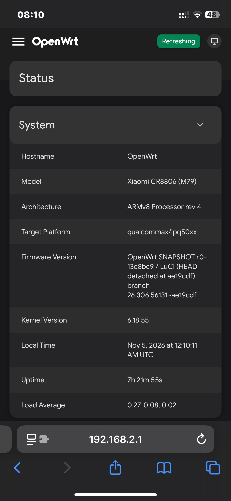
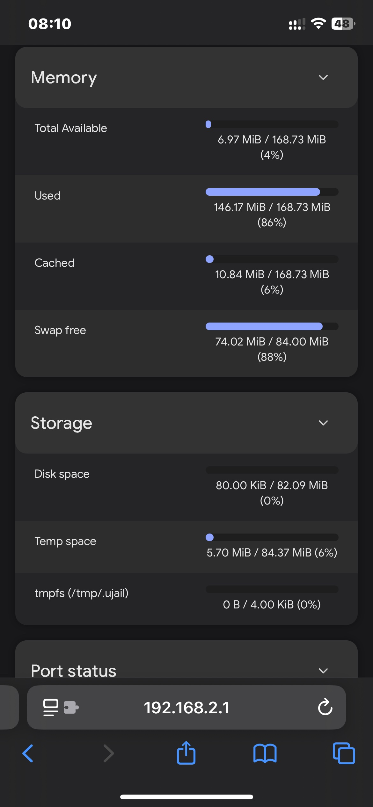
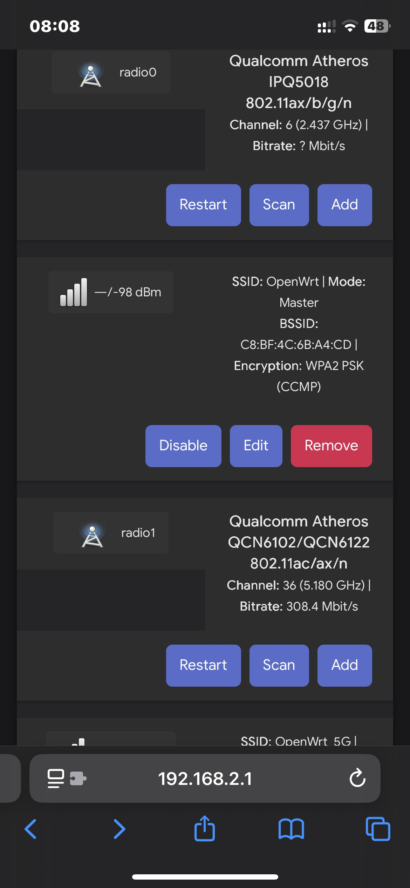
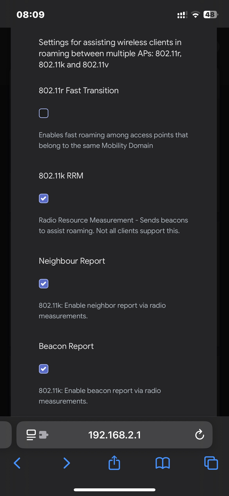
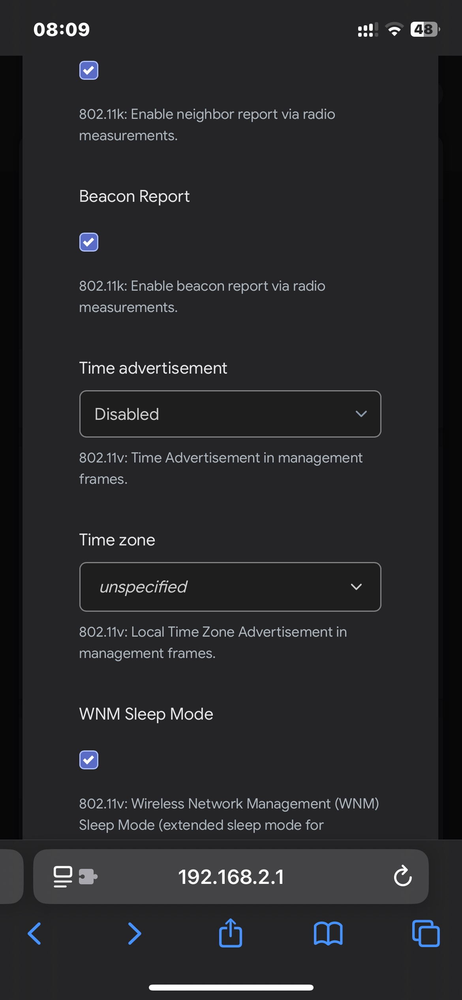

# CR880X IPQ5000 NSS

小米 CR880X（CR8806 / CR8808 / CR8809，同一硬件）IPQ5000 平台的 OpenWrt 固件自动编译项目：GitHub Actions 自动编译带 Qualcomm NSS 硬件加速的固件，目标是**最新内核 + 最强 NSS 加速**。本仓库只放编译脚本、配置和设备定义，不放底包源码；编译时 workflow 按钉住的提交克隆底包再编译。**CR8806 / CR8808 / CR8809 只是运营商后缀，硬件是同一套；真正分硬件的是主板版本——M79A、M81、B版。**本项目所有对外命名一律以主板版本（M79A / M81）为准，不用运营商型号当标签。

## 基础版本

| 项目 | 版本 / 钉住值 |
|---|---|
| OpenWrt 底包 | [kuncy7/openwrt-nss-edma](https://github.com/kuncy7/openwrt-nss-edma)，分支 `c3po-tag-8021q`，提交 `13e8bc914709c4794b3ec7b0421d2038386e697e` |
| 内核 | 6.18（6.18.55） |
| NSS 固件 | 12.5（12.5-210-MP；编译时可选 12.2，驱动必须与固件版本对应） |
| 目标 | `qualcommax/ipq50xx`，DSA 拓扑 |
| LuCI | Argon 为默认主题，Bootstrap 也在镜像里 |

| Feed | 钉住提交 |
|---|---|
| packages | `24f7c066` |
| luci | `ae19cdfd` |
| routing | `ea8633da` |
| telephony | `9bcb6d71` |
| video | `4582d70f` |
| nss | `4fa071ab` |

## NSS

- 全平面 NSS：qca-nss-drv + qca-nss-ecm、NSS 固件加载、dwmac NSS、ath11k NSS（wifili）、DSA NSS、QCA8337、PPPoE、VLAN、IPv6、虚拟接口
- NSS 内存档：LOW（默认）
- 已在 CR8808（A版 M79）上机验证：NSS 核心启动、有线平面转发零丢包、ECM 已加速 TCP 流、WiFi 测速时 CPU 几乎不变（双频 WiFi 走 NSS 路径）
- 内核 flow offloading（flowtable）必须保持关闭：NSS ECM 是 offload 路径，两者不能同时开
- bridge-mgr 不在 ipq50xx 上（仅 ipq807x/ipq60xx 的 PPE 栈有），未包含

## 固件特性

| 特性 | 支持 | 默认状态 | 实机测试 |
|---|---|---|---|
| NSS 加速 | 支持 | — | 已测试 |
| 双频 WiFi（出厂开启） | 支持 | 默认启用 | 已测试 |
| 802.11k（RRM） | 支持 | 默认启用 | 已测试 |
| 802.11v（WNM） | 支持 | 默认启用 | 已测试 |
| 802.11r（FT） | 支持 | 默认关闭 | — |
| 802.11s（Mesh） | 支持 | 默认关闭 | — |
| SQM（nssfq_codel + luci-app-sqm） | 支持 | 默认关闭 | — |
| Adblock | 支持 | 默认启用 | — |
| UPnP | 支持 | 默认关闭 | — |
| 内核流量分载（flow offloading） | 支持 | 默认关闭 | — |
| IGMP snooping | 支持 | 默认关闭 | — |
| zram-swap | 支持 | 默认启用 | 已测试 |

- 802.11v 靠 `bss_transition` + `wnm_sleep_mode` 开启；本底包的 ap.uc 不读 `ieee80211v`，不要用它（否则 v 不生效）
- 802.11s：完整版 wpad 带 Mesh 能力，LuCI 里可选 Mesh 模式，但默认不配 Mesh 接口、未上机测过
- 无线硬件：IPQ5018（2.4G）+ QCN6122（5G），ath11k，双频 WiFi 6（802.11ax）
- 完整版 wpad-mbedtls（与 basic 同为 mbedtls 后端，另含 WNM 与 MESH）；WPA3-SAE 可用
- DNS：dnsmasq-full + adblock（规则源 anti_ad / adguard / yoyo / disconnect，列表首次开机联网后下载）；LAN 53 端口 DNS 劫持到路由器本机；dnsmasq 缓存 1000；无 SmartDNS
- 网络：DSA（lan / wan）、BBR（首次开机设为默认拥塞算法）
- 工具：htop、zoneinfo-asia、luci-app-upnp、tcpdump-mini、iw（无线调试）、ca-bundle
- 不包含：SmartDNS、ttyd、SFTP/SCP、bridge-mgr、Fullcone、cpufreq、arpbind（feed 里没有或已确认不适用；要加功能请重编译，见下）
- 设备适配：merged 分区 fixed-partitions（单 rootfs 116.5 MiB）、trigsoft 链 4-bit NAND ECC、ART caldata（`0:ART`，脚本按大小写精确匹配）
- 编译优化：`-O3` + Cortex-A53 crypto 指令集、LTO 开启
- 内存：256 MiB 物理内存，Linux 可见约 170 MiB；大规则源（adblock XL/XXL/VAR）默认关闭，别贪大

### 出厂默认凭证（公开默认值，刷后可改）

| 项目 | 默认值 |
|---|---|
| WiFi 2.4G SSID | OpenWrt |
| WiFi 5G SSID | OpenWrt_5G |
| WiFi 密码 | 12345678（WPA2） |
| Root 密码 | password |

LuCI 密码页用户名默认 root，填新密码 + 确认 + 保存；或 SSH `passwd`。

## 支持的型号

| 固件（主板版本） | 支持的设备 | 芯片 | 状态 |
|---|---|---|---|
| **M79A** | CR8806 / CR8808 / CR8809（A版 M79，共用同一固件） | IPQ5000 + QCA8337；2.4G FEM MXD7223（无 PA）；5G QCN6122 + RTC66568 | 已在 CR8808（A版 M79）上机验证 |
| **M81** | CR8808（A版 M81）、Redmi AX3000（与 M81 同硬件）、Xiaomi AX3000（与 M81 同硬件） | IPQ5000 + QCA8337；2.4G FEM CTR66266；5G QCN6122 + RTC66568 | 均未上机验证 |
| — | CR881x（B版）及其他所有型号 | IPQ5018 + YT9215S；5G QCN6122；FEM 未确认 | 不支持，刷错变砖 |

（内部 profile 代号：M79A 对应 `xiaomi_cr8806`，M81 对应 `xiaomi_cr8808`——仅内部使用，不作对外标签。）

认板看主板版号 + 板型，不要只看型号：CR8808 有 M79 和 M81 两种主板；A版与 B版交换芯片不同，固件不通用。

## 刷机与首次开机

- 当前设备（trigsoft 合并分区，单 rootfs）：按住 reset 通电进 trigsoft web UI（192.168.10.1），刷 `factory.ubi`。`factory.ubi` 是 OpenWrt UBI 镜像，不是原厂格式，不要当原厂固件刷到别的分区。
- sysupgrade 不可用：本设备无平台升级脚本；升级请用 trigsoft web UI 重刷 `factory.ubi`（会清空配置）。
- 首次安装（原厂分区布局）：UART（115200 8N1）+ TFTP，启动 initramfs，把 `factory.ubi` 写到固件 UBI 分区；刷前备份原厂固件。
- 刷坏恢复：断电，按住 reset 再通电，多试几次进 trigsoft web UI，刷回已知好的固件。
- 首次开机：出厂 radio 全开，WiFi 与 root 均已设默认凭证（见上）；默认值是公开的，建议刷后改掉。

## 分区表

- 本固件要求合并分区表：内核 DTS 写死 fixed-partitions，rootfs 在 0xA80000、大小 0x7480000（116.5M），启动时按这个表找 UBI（`ubi.mtd=rootfs`，root 为 UBI 卷）。如果闪存里还是原厂四个分区，那里就没有一个 116.5M 的完整 UBI，UBI 挂不上，启动失败。
- 刷机不用提前准备分区表：合并分区表由 trigsoft 的 web U-Boot（[trigsoft/cr8808_web_uboot](https://github.com/trigsoft/cr8808_web_uboot)）在刷 UBI 时改写产生——先改表为合并，再写镜像。所以从原厂刷、从合并刷，刷完都是合并表，正好满足内核的要求。
- mtd0–17（SBL1、MIBIB、APPSBL、ART 等）原厂与合并一模一样；刷本固件不动 bootloader，只动固件区（0xA80000–0x7F00000）。

| 固件区（0xA80000–0x7F00000，共 116.5M） | 原厂 | 合并 |
| --- | --- | --- |
| 分区 | rootfs 36M + rootfs_1 36M + overlay 31M + data 13.5M（双槽） | rootfs 116.5M 一个分区（UBI：kernel + rootfs + rootfs_data，单槽） |
| overlay 空间 | 31M（独立分区） | ~82.5M（UBI 内的 rootfs_data，自动扩） |

- 刷机规则：走 trigsoft web UI（192.168.10.1）刷 `factory.ubi`——原厂、合并都能刷，刷完都能启动（刷完一定是合并表）。
- 别走：原厂 recovery、手动 mtd 写到 36M 的 rootfs 槽、sysupgrade（sysupgrade 本来就不可用）——那些路子不改表，刷完还是原厂表，内核起不来。
- M81 分区与 M79 相同，规则一样。

## 编译

- `.github/workflows/build-ipq50xx.yml`（瘦调用方）+ `build-ipq50xx-shared.yml`（共用构建），手动触发（`workflow_dispatch`）

| 输入 | 可选值 | 默认 |
|---|---|---|
| `device` | `M79A` / `M81` | —（必填） |
| `firmware` | `12.5` / `12.2` | `12.5` |
| `base_ref` | 底包提交 | `13e8bc914709c4794b3ec7b0421d2038386e697e` |

- 每次成功编译发一个独立 Release（tag `主板版本-内核-NSS-运行号-尝试号`，如 `M79A-6.18-12.5-21-1`）：先发 draft，验远端摘要通过后再发布，坏版永不公开；release 里只有固件（`factory.ubi`）；buildinfo、完整 `.config`、校验文件与第三方来源清单只作 workflow 诊断产物，不进 release
- 缓存：ccache 按工具链 + 编译器键入，staging / dl 按配置哈希键入；旧缓存与旧工作流自动清理（工作流保留 2 天，Release 不受影响）
- 要加功能请重编译：本项目不提供自建 kmod 仓库；kmod 包带内核 vermagic，只能装在同一编译的内核上

## 给 fork 者的建议与注意事项

建议：

- fork 后先钉住自己的 `base_ref` 与 feeds，不要跟分支走，否则无法复现
- 保留 defconfig 守卫、targetinfo DEVICE_PACKAGES 校验、无线校验、factory 结构校验：它们专防配置符号被 defconfig 静默丢掉
- 保留 draft → 验摘要 → 发布：不要直接发布未验的镜像
- 加设备先看 [docs/adding-devices.md](docs/adding-devices.md)：先把硬件定义清楚（丝印、FEM、caldata），再做 profile / DTS，回来复制配置、往 workflow 加映射，最后上机跑冒烟测试

注意事项（硬约束）：

- `nss-tools-dwmac` 必须 `=y`，不能 `=m`，否则 NSS 静默不工作且无任何报错
- 内核 flow offloading 必须关，否则 ECM 看不到流量
- 驱动必须与固件版本对应（12.5 驱动配 12.2 固件，或反过来，WiFi 计数器会一直是 0）
- ART 分区名大小写敏感：caldata 脚本按 `/proc/mtd` 精确匹配，`0:ART` 与 `0:art` 写错一个字母就没 WiFi；移植前先看自己板子的 `/proc/mtd`
- trigsoft 链 NAND ECC 用 4-bit；8-bit 会导致 trigsoft 写过的页无法解码（UBI 挂不上）
- 分区布局：合并分区用 fixed-partitions（smem-part 在 trigsoft 合并表上会失败）；原厂布局用 smem-part；两者不要混用
- M79 的 2.4G 没有 PA（MXD7223 只有 LNA + 收发切换）：2.4G 弱是硬件，改配置修不好；M81（CTR66266）才有正常 2.4G
- B版（YT9215S）在 NSS 树里没有 Linux 驱动，不要把 A版固件往 B版上刷
- NSS 固件是专有二进制 blob，不是开源软件；不要把它说成开源，也不要把它直接塞进仓库（编译时由 feed 链路获取）
- 各设备的 caldata 来自设备自己的 ART 分区，不要拷别的板子的 caldata
- 这是 SNAPSHOT，不是稳定版：底包与 feeds 已钉住以保证复现，rebase 时请重新钉住并验证

## 合规

- 发布镜像时一并附带当次编译的 `config.buildinfo` 与 `feeds.buildinfo`（workflow 已收集），这是 GPL 源码提供义务的一部分
- NSS 固件是专有二进制 blob，不是开源软件；caldata 来自设备自己的 ART 分区

## 实机截图

实机 LuCI 截图：

系统信息：Xiaomi CR8806 (M79)，OpenWrt SNAPSHOT，内核 6.18.55

内存状态：Total Available 6.97 MiB，Swap 84 MiB（zram 已启用）

无线概览：2.4G 信道 6，5G 信道 36（auto）

WLAN Roaming：802.11r 关闭，802.11k 开启

WLAN Roaming：802.11k/v 组件开启，Time Advertisement 关闭
